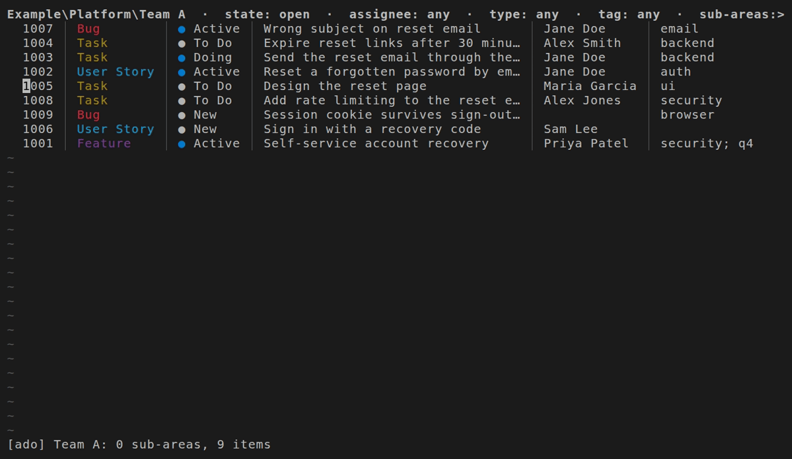
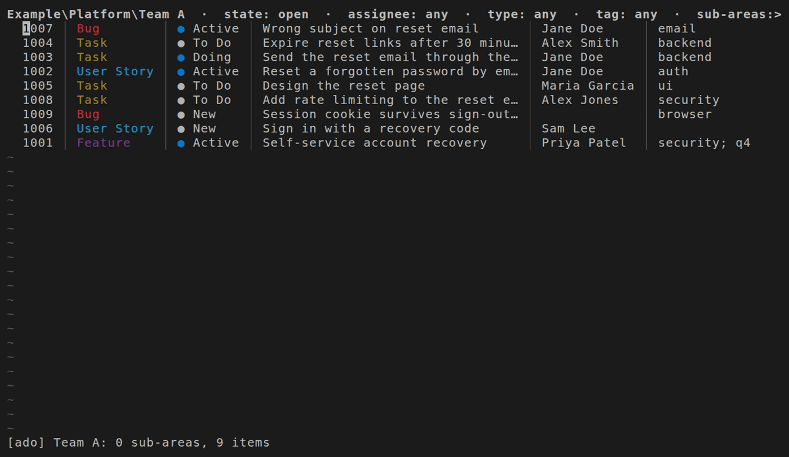
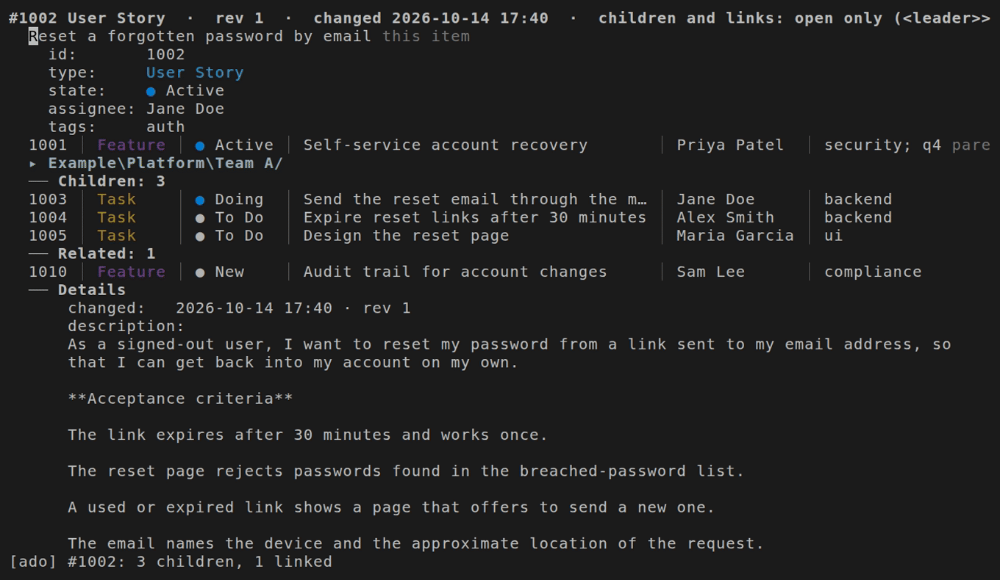
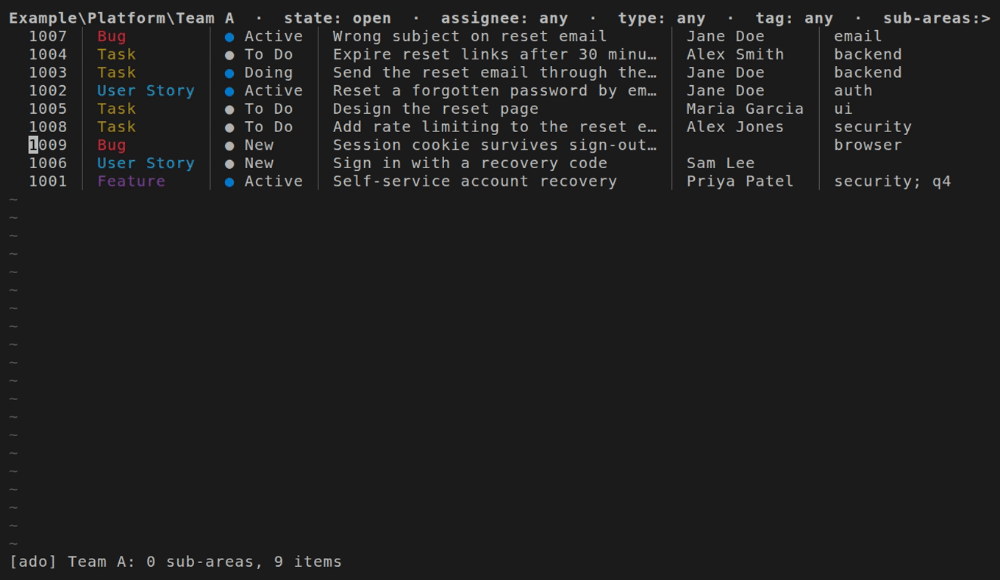

# nvim-ado-workitems

Browse and edit Azure DevOps (ADO) work items as Neovim buffers, and save every edit with `:w`.


## Requirements

- Neovim 0.10 or later.
- The Azure CLI (`az`) with the `azure-devops` extension, signed in with `az login`.
- Optional: `pandoc`, to edit descriptions as markdown; without it you edit their HTML.
- Optional: telescope.nvim, for text search with `require("ado").search()`.

## Getting started

With lazy.nvim:

```lua
{
  "xpcoffee/nvim-ado-workitems",
  main = "ado",
  opts = {
    org = "example-org",
    projects = { { name = "Example", types = { "Task", "User Story", "Bug" } } },
    area_paths = { "Example\\Platform\\Team A" },
    write_guard = { area = "Example\\Platform\\Team A" },
  },
  keys = {
    { "<leader>wa", function() require("ado").area_view() end, desc = "ADO area" },
    { "<leader>wm", function() require("ado").my_items() end, desc = "ADO my work items" },
  },
}
```

Press `<leader>wa` to open an area, or `<leader>wm` for your work items. The write guard fails closed: the plugin refuses every write until `write_guard.area` is set, and then writes only to items in that area and its sub-areas.

## What it does

### Browse an area or your work items (the GIF at the top)

`area_view()` lists the sub-areas and work items under an area path such as `Example\Platform\Team A`, and `my_items()` lists the open items assigned to you. Each list is a view, and `<CR>` opens an item in an item buffer beneath it.

### Edit rows and save with `:w`



Change titles, states, assignees and tags in place. `:w` opens a summary of every change, and nothing reaches ADO until you press `y` to confirm.

### Move rows with `dd` and `p`



`dd` in one area and `p` in another moves the item to that area. A row put under the Children heading of an item buffer gets that item as its parent.

### The item buffer



The item buffer shows the item's fields, parent, children and links, which you can edit, then its description and comments as read-only text. Comments load 5 at a time, newest first, as you scroll towards them.

### Menus for types, states and people



In Insert mode, `<C-Space>` in a type or state column lists the values the save accepts. In the assignee column it lists the people already in your open views, and adds the people ADO finds once you pause typing.

### Fit to the window


Rows fit the window without scrolling sideways: tags collapse, types shrink to one letter, and long cells end in `…`, while the save still sends full values. Resting the cursor on a shortened row shows the whole row in a floating window.

## Main keys

The plugin sets these in its own buffers; `<leader>wa` and `<leader>wm` come from your spec.

| Key | Where | Action |
| --- | --- | --- |
| `<CR>` | every view | open the item or sub-area under the cursor |
| `-` | area view | go to the parent area |
| `[h` / `]h` | every view | back / forward |
| `:w` | every view | review and save every edit |
| `<C-Space>` | Insert mode, in a cell | list types, states or people |
| `<leader>we` | Normal or Visual mode | pick a value for the cell, or for the column of every selected row |
| `<leader>wf` | area view, my work items | set the filters |
| `<leader>wd` | item buffer | edit the description |
| `<leader>wc` | item buffer | add a comment, sent at once |
| `<leader>wr` | every view | reload |

## More

[docs/usage.md](docs/usage.md) covers every option, the write guard's rules, each view's full list of keys, and what each edit does when you save. [docs/architecture.md](docs/architecture.md) explains how the plugin is built.

## Licence

MIT, see [LICENSE](LICENSE).
