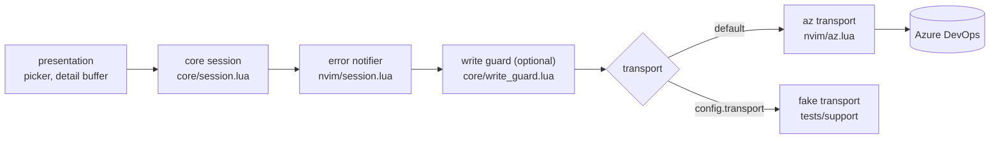

# Architecture

How the plugin reaches Azure DevOps (ADO), what stands between an edit and a
write, and how the tests run the core without Neovim. This is the current
view; the plan in `docs/plan/0001-implementation-plan.md` records how it got
here.

## Layers

The plugin has two layers. The **core** (`lua/ado/core/`) holds behaviour:
work item normalisation, query building, the type catalog and the session.
It never touches `vim`. The **presentation** layer (`lua/ado/nvim/`) owns
buffers, windows, keymaps, notifications and the `az` CLI transport.

The core reaches ADO only through a **transport**: a table of asynchronous
operations, `transport.<op>(params, cb)`, defined in
`lua/ado/core/transport.lua`. Two transports implement it: the `az` transport
(`lua/ado/nvim/az.lua`), which runs the `az` CLI, and the in-memory fake
(`tests/support/fake_transport.lua`), which the tests use.

`lua/ado/nvim/session.lua` builds the one session per editor. It wraps the
transport twice before handing it to the core:



The order matters. The error notifier sits outside the write guard, so a
refused write is reported to the user like any other failure, and the guard
sees the raw errors from the transport. Because the notifier reports every
transport failure, code that calls core session methods must not notify the
same error again. Errors the core raises itself, such as the `conflict` from
`Session:update_if_unchanged`, do not pass through the notifier, so callers
report those.

## Projects and type catalogs

`az boards query --project P` does not limit a query to project P: it
searches the whole organisation. The session therefore adds
`[System.TeamProject] IN (...)` to every list query, naming the projects in
the `projects` setting. Without that setting, the one project chosen through
`project`, `$AZURE_DEVOPS_EXT_DEFAULT_PROJECT` or the first-use picker is the
list.

"Open" depends on the project: two projects can define a type with the same
name and put the same state in different categories. The session keeps one
type catalog per project (`Session:catalog(project, cb)`), loaded with one
`az` call the first time a list needs it and kept for the session. An
open-only list loads the catalog of every listed project and pairs each
project with its own condition, so each item is judged by its own project:

```text
[System.TeamProject] IN ('A', 'B')
AND (([System.TeamProject] = 'A' AND <A's open states per type>)
  OR ([System.TeamProject] = 'B' AND <B's open states per type>))
```

A list in every state needs no catalog. Each project's `types` is the set of
types its rows may be created as or changed to (used from phase 5 of the
plan); it does not filter which items lists show.

## Area view

An area view lists one area's direct sub-areas, then its work items under
the view's filters. The core (`core/area_view.lua`) loads it with two calls
run together: `area_children` for the sub-areas and one `query` for the
items, plus the project's type catalog the first time an open-state view of
that project loads.

Area paths come in three forms (`core/area_path.lua`). Work items and WIQL
use the field form, `Example\Software\Team`. ADO's area tree
(classification nodes, which `area_children` reads) puts an `Area` segment
after the project, `\Example\Area\Software\Team`, and the project's
root area is `\Example\Area`. Buffer names and the configuration also
accept `/`.

A location names what a view shows (`core/location.lua`): the area path,
the filters and the sub-area toggle. It encodes to the buffer name, for
example `ado://area/Example/Software/Team?state=open&type=&assignee=&tag=&sub=0`,
so each combination has its own buffer. Back and forward walk one shared
history of locations (`core/history.lua`).

Each row starts with a session-wide row ID, `/12 `, which the buffer
conceals; `nvim/registry.lua` maps it to what the row shows. Rows are read
by ID, never by matching text, so two items with the same title stay apart.
In this phase views are read-only: `:w` saves nothing.

The browser URL (`<leader>wb`) runs the view's query in ADO's web UI. The
web UI rejects URLs over about 3,050 characters (measured: 3,053 loads,
3,061 gets HTTP 404), and the open-state condition for every type of a
project is long. Two things keep the URL short. Types with the same open
states share one clause of the condition. And for an open-state view, the
condition covers only the types of the loaded items: as of the load, it
returns the same items, because every open item of another type would have
been loaded too. A truncated view (more items than `default_query_top`)
keeps the condition for every type, since its loaded items may not show
every type. A URL still over 3,000 characters is refused with a warning.

## Item view

An item view shows one work item: its own row, its parent, its area, its
children, then one section per link type in the `link_types` setting
(Related by default). The core (`core/item_view.lua`) loads it with two
calls: `get_work_item` with relations, then one `[System.Id] IN (...)`
query for every linked item. Children and links are fetched in every state
and filtered by the open-state rule when rows are built, so the all-states
toggle (`<leader>wt`) makes no call. The parent row shows in any state.

The core keeps two things apart. A **view** is what was loaded. A
**display** is one showing of it, and holds the inline expansions: `<Tab>`
on a child row runs one `[System.Parent] = N` query and inserts that
child's children beneath it, and `<Tab>` again removes them with no call.
Each new display starts collapsed, so going back to an item shows it
collapsed. Expansion inserts and deletes buffer lines rather than redrawing
the buffer, so the editing phases can keep unsaved edits through it.

An item location is the work item ID and the toggle. Its buffer is
`ado://item/<id>` whatever the toggle, since the toggle only filters rows
already loaded; the history still records the toggle as a step.

## Layout and history

`nvim/layout.lua` keeps up to three windows, one per role, stacked top to
bottom in one column: the area view, the item view panel, then the detail
split. A role with nothing open has no window, and the open ones share the
column's height equally. Selecting an
item in the area view shows it in the detail split and in the panel, and
leaves the cursor in the panel. `K` in the panel shows the item under the
cursor in the detail split without moving the cursor; `gd` moves to it.
`<leader>wi` in a detail buffer opens the panel above it.

A role reuses its window while that window is in the current tab and still
shows a buffer of that role, so a window the user has put another buffer
in is left alone and a new split is made. Area and item locations share one
history (`layout.history`); back and forward show each location in its
role's window.

## Write guard

The write guard (`lua/ado/core/write_guard.lua`) limits which work items the
plugin may change. It exists for agent-run and manual tests against the real
organisation: an organisation may watch work items of one type, such as `Issue`, so a test
write to one could notify people. It is unrelated to the revision check in
`Session:update_if_unchanged`, which refuses a write when the item changed in
ADO since it was loaded.

It is off by default. Turn it on through `setup()`:

```lua
require("ado").setup({
  write_guard = { area = "Project\\Area", deny_types = { "Issue" } },
})
```

With the guard on:

- Reads pass through unchanged.
- A write is allowed only for an item in `area` or one of its sub-areas.
  Area paths compare case-insensitively, and `/` is accepted for `\`.
- A write to an item whose type is in `deny_types` is refused, and so is a
  change of type to a denied type. `deny_types` defaults to `{ "Issue" }`.
- With no `area` set, every write is refused.
- An operation the guard has no rule for is refused, so an operation added to
  the transport later is blocked until someone writes its rule.
- A refusal never reaches the transport. The caller receives an error of kind
  `invalid` whose message starts `write guard refused <operation>`.

For a write to an existing item, the guard first reads the item with
`get_work_item` to learn its area and type. The read and the write are two
calls, not one atomic step: an item moved between them is not caught. If the
read fails, the guard refuses the write.

## The `transport` config option

`setup({ transport = t })` replaces the `az` transport with `t`, which must
implement every operation in `transport.OPERATIONS`; the session raises at
creation if one is missing. The presentation specs pass the fake here. The
write guard and the error notifier wrap whichever transport is configured.

## Test sandbox

`make test` runs `tests/run.lua` in headless Neovim. The runner:

1. Replaces every process-starting function (`vim.system`, `vim.fn.system`,
   `vim.fn.jobstart`, `io.popen`, `os.execute` and others) with one that
   raises, so no test can reach `az` or the network. A spec that exercises the
   `az` transport passes its own `system` function to `az.new`.
2. Scans `lua/ado/core/` line by line for `vim.` and for requires of
   `ado.nvim` modules, as a backstop for core code no test runs.
3. Runs `tests/core/` specs in the sandbox (`tests/support/sandbox.lua`): a
   fresh environment per spec file that raises when code reads `vim` or the
   loader and debug globals, and that allows requires of `ado.core.*` and
   `tests.*` only. This enforces RFC 0001 R6.1: the core must not reference
   Neovim.
4. Runs `tests/nvim/` specs with the real `vim`, against the fake transport.
