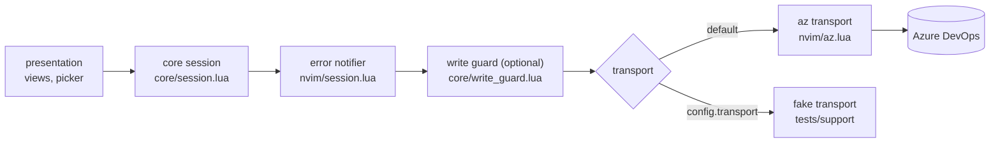
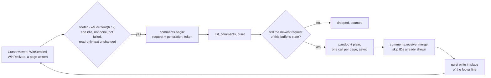
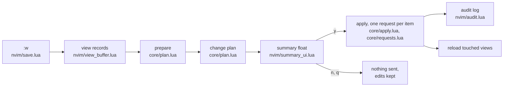
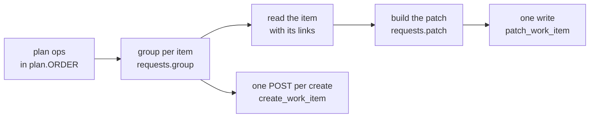

# Architecture

How the plugin reaches Azure DevOps (ADO), what stands between an edit and a
write, and how the tests run the core without Neovim. This is the current
view; the plan in `docs/plan/0001-implementation-plan.md` records how it got
here.

## Layers

The plugin has two layers. The **core** (`lua/ado/core/`) holds behaviour:
work item normalisation, query building, the type catalog and the session.
It never touches `vim`. The **presentation** layer (`lua/ado/nvim/`) owns
buffers, windows, keymaps, notifications and the `az` CLI transport.

The core reaches ADO only through a **transport**: a table of asynchronous
operations, `transport.<op>(params, cb)`, defined in
`lua/ado/core/transport.lua`. Two transports implement it: the `az` transport
(`lua/ado/nvim/az.lua`), which runs the `az` CLI, and the in-memory fake
(`tests/support/fake_transport.lua`), which the tests use.

`lua/ado/nvim/session.lua` builds the one session per editor. It wraps the
transport twice before handing it to the core:



The order matters. The error notifier sits outside the write guard, so a
refused write is reported to the user like any other failure, and the guard
sees the raw errors from the transport. Because the notifier reports every
transport failure, code that calls core session methods must not notify the
same error again. Errors the core raises itself do not pass through the
notifier, and neither does a `conflict` from the transport, so callers
report those: the caller knows which rev it expected and how the user can
recover. While a save applies, `nvim/save.lua` mutes the notifier
(`session.mute_errors`), because the save's report carries the error. A
single call can also pass `quiet = true` in its params, which transports
ignore and the notifier honours: the assignee menu (`nvim/people.lua`)
searches on every pause in typing, so it reports a failed search itself,
once per Insert session, instead of once per search.

## Projects and type catalogs

`az boards query --project P` does not limit a query to project P: it
searches the whole organisation. The session therefore adds
`[System.TeamProject] IN (...)` to every list query, naming the projects in
the `projects` setting. Without that setting, the one project chosen through
`project`, `$AZURE_DEVOPS_EXT_DEFAULT_PROJECT` or the first-use picker is the
list.

"Open" depends on the project: two projects can define a type with the same
name and put the same state in different categories. The session keeps one
type catalog per project (`Session:catalog(project, cb)`), loaded with one
`az` call the first time a list needs it and kept for the session. An
open-only list loads the catalog of every listed project and pairs each
project with its own condition, so each item is judged by its own project:

```text
[System.TeamProject] IN ('A', 'B')
AND (([System.TeamProject] = 'A' AND <A's open states per type>)
  OR ([System.TeamProject] = 'B' AND <B's open states per type>))
```

A list in every state needs no catalog. Each project's `types` is the set of
types its rows may be created as or changed to (used from phase 5 of the
plan); it does not filter which items lists show.

## Area view

An area view lists one area's direct sub-areas, then its work items under
the view's filters. The core (`core/area_view.lua`) loads it with two calls
run together: `area_children` for the sub-areas and one `query` for the
items, plus the project's type catalog the first time an open-state view of
that project loads.

Area paths come in three forms (`core/area_path.lua`). Work items and WIQL
use the field form, `Example\Software\Team`. ADO's area tree
(classification nodes, which `area_children` reads) puts an `Area` segment
after the project, `\Example\Area\Software\Team`, and the project's
root area is `\Example\Area`. Buffer names and the configuration also
accept `/`.

A location names what a view shows (`core/location.lua`): the area path,
the filters and the sub-area toggle. It encodes to the buffer name, for
example `ado://area/Example/Software/Team?state=open&type=&assignee=&tag=&sub=0`,
so each combination has its own buffer. Back and forward walk one shared
history of locations (`core/history.lua`).

Each row starts with a session-wide row ID, `/12 `, which the buffer
conceals; `nvim/registry.lua` maps it to what the row shows. Rows are read
by ID, never by matching text, so two items with the same title stay apart.
Views are edited in place and saved with `:w`; see "Saving views" below.
In Normal mode the cursor is moved out of the concealed prefix
(`view_buffer.lua`, on `CursorMoved`), because it shows on the first
visible character there and `yiw` would yank the hidden `/`.

An item row's cells are, in order:

```text
/12 900033 │ Task │ To Do │ Fix the login │ Alex Smith │ api; backend
    id       type   state   title           assignee     tags
```

The **id** cell shows the work item's ID so it can be copied; it is
display only. The row ID prefix, not the id cell, says which item a line
is, so moves and copies are decided as before. The parse rule
(`nvim/lines.lua`, `core/table_layout.lua`) takes id, type and state from
the first three separators and assignee and tags from the last two, so a
title holding `│` stays one cell. Child rows under an expanded row are
indented in the type cell, the layout's **indent cell**, so the IDs line
up in one column. A parsed row holds the id cell's text as `shown_id`,
apart from `id`, the work item ID of a loaded row.

Item rows are padded with real spaces to the widest cell of each column,
up to the widths that fit the window (`core/table_layout.lua`; see
"Fitting the window" below). After a change of the user's, `nvim/realign.lua`
re-pads: it rewrites only the runs of spaces that no longer line up, with
`nvim_buf_set_text` after `:undojoin`, so the change and its re-pad are one
undo step, and the row ID prefixes and end-of-line labels stay in place.
It does nothing for a load, an expansion or a save's reload, which render
aligned; for a view with no unsaved edits; and at an undo state older than
the newest, where `:undojoin` fails with E790 and every state is aligned
already. On `InsertLeave` it waits one event loop turn, because a blockwise
insert copies the typed text to the other selected lines after
`InsertLeave`, reading it back from the first line. The plan trims every
cell, so a re-pad never changes what a save sends. `nvim/cells.lua` finds
the cell under the cursor by the same ranges, for the `ic` and `ac` text
objects.

Type and state cells offer their valid values. `core/choices.lua` decides
which: for a type, the project's configured `types` that its catalog has;
for a state, the states of the type the save would check it against,
which is the type typed on the line when the save would change the row to
it, else the loaded type. It applies the save's own rules, and the save's
messages for a project with no `types` and for a new line with a state
live there, so a menu never offers what the save refuses and both explain
a refusal in the same words. For several cells it keeps only the values
every cell may take. `nvim/complete.lua` shows them in Insert mode with
`complete()`, called from a plain Lua mapping (from an `<expr>` mapping it
fails), and as the buffer's `completefunc`; it loads a catalog the session
has not loaded yet and opens the menu only if the cursor is still in the
same cell. `nvim/pick.lua` shows them with `vim.ui.select` for `<leader>we`
and writes the choice into each cell with `nvim/cells.lua`, then re-pads,
so the write and its re-pad are one undo step. The views turn nvim-cmp off
in their buffers (`require("cmp").setup.buffer({ enabled = false })`, also
on `InsertEnter`, for a config that loads nvim-cmp then): nvim-cmp installs
its Insert-mode keys only in buffers where it is enabled, so the views'
buffer-local `<C-Space>` then wins over nvim-cmp's global one.

Colours come in two kinds. What the text alone decides (separators,
sub-area rows, headings) is drawn by syntax rules in `syntax/adoarea.lua`
and `syntax/adoitem.lua`, which cost nothing per edit. What depends on the
data is drawn by `nvim/decorations.lua` with extmarks, placed again after
every change once the re-pad has run: the type cell in its type's ADO
colour, a dot before the state cell in the state's colour (inline virtual
text, the same width on every row, so the columns stay aligned on screen
and `<C-v>` still selects a column), and a sign on each changed or new
line. The colours are in the type catalog, from the `workitemtypes` call
the session already makes; a view in every state, which loads no
catalog, asks for its project's catalog once and is decorated again when
it arrives. Which rows are changed or new comes from
`core/row_changes.lua`, the comparison the change plan uses, so a marked
row and the save summary cannot disagree. `nvim/highlights.lua` defines
the `Ado*` groups as default links to standard groups, one `AdoColor_<hex>`
group per ADO colour, and defines them again on `ColorScheme`.

The browser URL (`<leader>wb`) runs the view's query in ADO's web UI. The
web UI rejects URLs over about 3,050 characters (measured: 3,053 loads,
3,061 gets HTTP 404), and the open-state condition for every type of a
project is long. Two things keep the URL short. Types with the same open
states share one clause of the condition. And for an open-state view, the
condition covers only the types of the loaded items: as of the load, it
returns the same items, because every open item of another type would have
been loaded too. A truncated view (more items than `default_query_top`)
keeps the condition for every type, since its loaded items may not show
every type. A URL still over 3,000 characters is refused with a warning.

### Fitting the window: cut cells and their full values

Neovim scrolls a window sideways by every column before the cursor,
including concealed text and inline virtual text, so a row is fitted by
its real text: the row ID prefix and the state dot count towards its
width, and one column stays free for the cursor after the last character
in Insert mode. `core/table_layout.lua` picks the column widths for a text
width (`budget`): the id column takes its full width first and is never
cut, since a cut ID could not be copied; columns whose cells are short
keep their width, the title gets the rest and no less than 20 columns,
and when that is not enough the tags collapse to `…`, the type shows as a
letter, then the assignee shortens to 8 columns. A tags cell collapsed to `…` keeps its
separator, so every row parses by the one rule above in any layout.

A cell longer than its column is cut in the buffer text and ends in `…`
(option T of plan 0002, chosen by the owner on 2026-10-15). The text
alone no longer says what the cell holds, so each cell that has been cut
or edited has a **shown map** in its row's registry entry
(`nvim/fit.lua`): every text the cell has shown, paired with the value it
stands for, starting with the loaded value. The rules that read it are
pure, in `core/fit.lua`:

- **Lookup.** A cell with no map is its text. A cell with a map has the
  value the map gives its text, and no value at all for a text the map
  does not know. A type is the exception: the save checks it against the
  project's types, so a type typed over its letter is that type.
- **Restore.** The re-pad after an edit (`nvim/realign.lua`) gives each
  edited cut cell its full value back. A cut text is a head of the value
  followed by `…`; when the edited text still ends in `…`, the edit lay in
  the head, and the value is the new head followed by the part the text
  before the edit hid (`table_layout.restore`). The cell is then cut again
  and the map learns the new text, in the same undo step as the edit, so
  after `u` or `<C-r>` the text in the buffer finds its value with no state
  to rewind.
- **The text before the edit.** The re-pad keeps a snapshot of every
  cell's text and the undo state it was taken at. The snapshot is trusted
  only when that state lies on the path from the undo tree's root to the
  newest change; after a `u` the re-pad never saw, it is not, and the
  hidden part is not known.
- **Whole replacements.** `cic`, `dic`, a value picked from a menu
  (`CompleteDone`), `<leader>we` and `<leader>wx` replace a cell whole, so
  the next re-pad takes the text as the value instead of restoring it.
- **Fail closed.** An edit that deleted the `…`, typed after it, or was
  made from an untrusted state leaves the cell with no value. The map
  records the text as having none, so editing it further keeps it so, and
  `u` back to a known text, or typing the `…` back, recovers it. A text
  that reads as a cut of the loaded value (a head of it followed by `…`)
  in a cell with no map has no value either.

Two guards stand between a cut text and ADO. `view_buffer.record` puts
each cell's full value in the view record and names every cell with no
value in the row's `ambiguous` list; `core/plan.lua` rejects such a row
(UX5.4), leaves the cell out of the edits and the assignee lookups, and
so a rejected save sends nothing. And the save summary shows every title
change in full, old and new, before `y`.

A cell shown in two lines (a copy, `yyp`) or pasted into another view has
the same row ID and so the same map, which is how a paste between views
of different widths finds its full values and is cut again to the new
view's widths. The maps go with the registry entries, which a reload
releases. A view with no unsaved edits is laid out again when a window
showing it changes size (`WinResized`, `VimResized`, `BufWinEnter`), for
the narrowest window showing it, rewriting only the lines that change
and outside the undo history, as a load is. A view with unsaved edits
keeps its layout, because the rewrite would be an undo step between the
user's edits, and says so in its window bar. A typed new line has no row
ID and so no map, and is never cut. `nvim/hover.lua` shows a cut row in
full in a float, from `core/row_info.lua`, and `<leader>wx`
(`nvim/reveal.lua`) writes a cell's full value into the buffer, where it
stays uncut until the next render.

## Query lists

A query list shows the work items one fixed query finds, under the area
view's state, type and tag filters (RFC 0001 R9). One exists: `mine`, the
items assigned to the user, which `my_items()` opens. The core
(`core/query_view.lua`) loads it with one `query` across the configured
projects, plus the type catalog of each project not loaded yet when the
state filter is "open". As in every list, each project's open condition is
paired with that project (see "Projects and type catalogs").

A query location is the query's name and its filters
(`core/location.lua`); the query fixes some filters, and `mine` fixes the
assignee to `@Me`. Its buffer is `ado://query/mine?state=open&type=&tag=`.
The browser URL keeps the area view's length rules: for an open-state list
that is not truncated, each project's open condition covers only the types
the list loaded from that project.

A query list's rows stand for no relationship, so saving treats them
differently from area view rows; see "Saving views".

## Item view

An item view shows one work item: its own row, its parent, its area, its
children, then one section per link type in the `link_types` setting
(Related by default). The core (`core/item_view.lua`) loads it with two
calls: `get_work_item` with relations, then one `[System.Id] IN (...)`
query for every linked item. Children and links are fetched in every state
and filtered by the open-state rule when rows are built, so the all-states
toggle (`<leader>wt`) makes no call. The parent row shows in any state.

The core keeps two things apart. A **view** is what was loaded. A
**display** is one showing of it, and holds the inline expansions: `<Tab>`
on a child row runs one `[System.Parent] = N` query and inserts that
child's children beneath it, and `<Tab>` again removes them with no call.
Each new display starts collapsed, so going back to an item shows it
collapsed. Expansion inserts and deletes buffer lines rather than redrawing
the buffer, so the editing phases can keep unsaved edits through it.

An item location is the work item ID and the toggle. Its buffer is
`ado://item/<id>` whatever the toggle, since the toggle only filters rows
already loaded; the history still records the toggle as a step.

### The item buffer: header, boundary and read-only region

The item view's rows are the **header** of the item buffer (RFC 0003).
`core/item_view.rows` ends them with a fixed **boundary row**, `── Details`.
Below it the presentation layer writes the **read-only region** as plain
text, without row IDs: the details (`core/item_details.lua`: a `changed:`
line and the description as markdown, wrapped to the window), then the
comments ("Comments paging" below). These lines are never rows, so the
change plan never receives them.

```text
/1 Checkout story              header: rows with row IDs, edited and saved with :w
/2   id:       100             the item's ID, read-only
/3   type:     User Story
...
/10 ── Related: 1
/11 105 │ User Story │ New │ ...
/12 ── Details                 boundary row: a fixed row, the last row
    changed:   2026-10-01 11:00 · rev 1      read-only region: plain text
    description:
    Let customers pay at checkout.
── Comments: 8
2026-09-15 13:58 · Alex Smith
    Looks right to me.

── 1 of 8 comments shown; move down to load more     footer line: the last line
```

`nvim/region.lua` keeps, per item buffer, an extmark on the boundary line
and the text the plugin last wrote from the boundary on. The **header end**
is the number of lines above the boundary: the extmark's line, or the line
of a boundary row pasted higher up. Every module that reads buffer lines as
rows reads them through `region.lines()` or checks `region.readable()`:
the view record, the re-pad and fitting (`nvim/realign.lua`,
`nvim/fit.lua`), conceal and refit (`nvim/view_buffer.lua`), decorations,
the cell text objects, the Insert-mode menus, `<leader>wx` and the
cut-cell float. A details line that holds `│` is therefore never re-padded,
marked or offered a menu, and a line starting `/123 ` is never concealed.

Neovim cannot make some lines read-only, so the save guards the region
instead, and three rules reject a plan (`core/plan.lua`) before anything
is sent for any view:

- **Read-only text changed.** `item_view.record` compares the lines from
  the boundary on with the text the plugin wrote, and passes the first line
  that differs as `readonly_changed`; the plan rejects with "the details
  and comments are read-only; u undoes the change, <leader>wr reloads".
- **Boundary deleted or moved.** The record holds the header's rows and
  then the boundary row when it is still where the header ends, so a
  deleted or moved boundary rejects like any fixed line.
- **Row below the boundary.** A row the plan reads after the boundary
  row rejects; with the boundary in place this cannot happen, since the
  record stops there.

Entering Insert mode on the boundary or below runs `stopinsert` and says
why, so most accidental edits never happen.

The plugin's own writes into the region (a staged description, and the
comment pages below) must leave the user's header edits
undoable. Neovim leaves a change out of the undo history only with
`'undolevels'` at -1, and then clears the whole history.
`nvim/quiet_edit.lua` therefore writes the history to an undo file
(`:wundo`), makes the change, writes a second undo file for the new text,
copies the second file's text hash and line count (the 36 bytes after the
11-byte header) into the first, and reads it back with `:rundo`. The
change adds no undo step, `u` still undoes the header edits made before
it, and the modified flag is restored. If any step fails, the history is
cleared, `ux_stats` counts `quiet_write_failed` and the user is warned
once. `make bench` times it with 100 undo steps.

**The description** is edited as markdown in a float and **staged**:
`<C-s>` keeps the text, converted to HTML with pandoc, in the buffer's
state, rewrites the details with a quiet write and marks the buffer
modified (a `TextChanged` handler sets the flag again when `u` reaches the
loaded header, because the history does not hold the staged text). The
record carries it as `description = { html, added, removed }`, and the plan
adds one `update` of `System.Description` to the item's ops, so it goes in
the item's one patch after the `test` on `/rev`, and the summary lists
"description changed". Text equal to the loaded description stages
nothing.

### Comments paging

Comments are read with `list_comments`, a read in the transport contract
that the write guard passes unchanged. The `az` transport calls
`GET {org}/{project}/_apis/wit/workItems/{id}/comments?api-version=7.1-preview.4&$top=5&order=desc`
with `az rest`, adding `&continuationToken=<token>`, URL-encoded once, for
every page after the first. ADO's token is the created date of the next
page's first comment and is absent on the last page.

`core/comments.lua` holds one item buffer's paging state, and
`nvim/item_comments.lua` writes it into the buffer:



- The heading's count is `System.CommentCount` from the item load, so an
  item with no comments makes no call. The first page loads by the same
  rule as the others, so an item whose comments are off-screen costs no
  call until the user moves towards them.
- At most one page is in flight per buffer. A response is merged only when
  it answers the state's in-flight request, with the same generation (each
  explicit reload makes a new state with the next generation) and the same
  token. A comment already shown is skipped, because two comments created
  in the same 100 ns would sit on both sides of a token. "All shown"
  follows the absent token, not the count.
- A page replaces the footer line, the buffer's last, through
  `view_buffer.replace_readonly`, a quiet write: no undo step, the modified
  flag kept, the header untouched. While the read-only text differs from
  what the plugin wrote, paging stops, because the footer's place is not
  known; the last line shows why at its end, and pages merged meanwhile are
  written once the change is undone.
- A failed page leaves the comments shown, puts the reason in the footer,
  reports one line in `:messages` (the call is quiet, so the notifier does
  not report it too) and is not retried until `<CR>` on the footer.
- The reload after a save keeps the state and updates the count; the
  heading then says how many are new. An explicit reload starts again.
  After `<leader>wc` the header reloads, the first page is read again,
  and the new comments go first.
- `ux_stats()` reports `comment_page` (pages written, last and largest
  durations, from the call to the write), `comment_page_failed` and
  `comment_page_dropped`.

## Layout and history

`nvim/layout.lua` keeps up to two windows, one per role, stacked top to
bottom in one column: the list (an area view or a query list) and the item
buffer. A role with nothing open has no window. With both open, the item
window gets two thirds of the column's height (`layout.ITEM_SHARE`), since
it holds the details too; alone it takes the column. Selecting an item in
a list, `open(id)`, `open_prompt()` and the search picker's `<CR>` show the
item buffer in the item window and leave the cursor there. `K` shows the
row's item in a float from one `get_work_item` call, keeping the cursor;
`gd` does what `<CR>` does.

A role reuses its window while that window is in the current tab and still
shows a buffer of that role, so a window the user has put another buffer
in is left alone and a new split is made. Area, query and item locations
share one history (`layout.history`); back and forward show each location
in its role's window. `toggle_area_view()` closes the list window, or
reopens the list it showed last, area view or query list.

## Saving views

A view is edited as text, and `:w` in any view saves the edits of every
modified view at once (RFC 0001 R5.2). The title, state, assignee, tags
and type columns, and the item view's field lines, edit those fields (see
"Column edits" below). A row's position stands for a relationship, so deleting,
pasting and moving rows changes relationships:

| Edit | Area view | Item view: children | Item view: parent row | Item view: other links |
| --- | --- | --- | --- | --- |
| Delete only | no change (R5.4) | remove the link to the parent | remove the link to the parent | remove the link |
| Paste, original kept | copy in this area | copy under this parent, or add the parent if the item has none | set the parent if the item has none, else reject | add the link |
| Delete and paste | change the area | change the parent | change the parent | move the link |
| New line | create in this area | create under this parent, in its area | reject | reject |

A query list's rows stand for no relationship (RFC 0001 R9.4 to R9.7).
Their column edits save as in the other views. Deleting one with no paste
anywhere is "no change", and pasting a row or adding a line in a query
list rejects the save. A row cut from a query list pairs with the one
paste of that item into an area view or a child list, and moves that
view's relationship: the area, or the parent from the one the row was
loaded with (the rows select `System.Parent`). A paste into a parent row
or a link section does what it does when the original is kept. More than
one such paste of one cut rejects (R5.10). A yanked row is a copy, as from
any view.

Lines keep their identity through yank, delete and put, because each line
starts with a concealed row ID and the registry maps it to the row it
showed (`nvim/registry.lua`). A row ID from another buffer is a pasted row;
an ID the registry no longer holds (its view reloaded since the yank)
rejects the save.



1. **View records.** For each modified view, `view_buffer.record` pairs the
   rows shown at the last load (from the row ID registry) with the rows
   parsed from the buffer now; a pasted row also carries its origin row.
   A cell cut to fit the window carries its full value, and a cut cell
   with no known value is named in the row's `ambiguous` list (see
   "Fitting the window"). The core never reads buffer text (R6.2).
2. **Prepare.** `plan.prepare` loads the type catalogs the state checks
   need (usually cached, so 0 calls), one `resolve_identity` per distinct
   edited assignee text (R5.19), and, for the cycle check (R5.12), the
   ancestors of every new parent that no loaded row already shows, one
   `get_work_item` per level. `plan.compute` then makes no calls, so an
   unknown or ambiguous assignee rejects before anything is written.
3. **Plan.** In an item view, the fixed lines (the item's own lines, the
   area row and the headings) mark which relationship the rows below them
   stand for, so deleting or moving one rejects the save. The plan sorts
   every row into "in place", "removed" or "added" per relationship across
   all views, then decides per item: a removal and one addition is a move,
   an addition with the original kept is a copy (R5.6), and one cut pasted
   twice (R5.10) or a second parent (R5.9) rejects. An expanded row and the
   rows shown beneath it move as one block (R5.8). Title and state edits to
   one item are combined across views, and conflicting ones reject (R5.10).
4. **Summary.** Rejections first, then link removals, link additions,
   parent and area changes, type changes, field changes, copies, new
   items, warnings and rows with no change (R7.2). Link removals, copies
   and type changes have their own line kinds, which the float highlights.
   A warning says when a destination view's filters will hide an item
   after reload (R5.13). `y` applies; `n`, `q`
   or `<Esc>` cancels and leaves every buffer as edited. With any rejection
   only cancel is offered, so a rejected plan never writes. A plan with
   nothing to send shows its notes as a message and reloads the views.
5. **Apply.** The plan's ops are grouped into one write request per work
   item (`core/requests.lua`), and the requests run one at a time; see
   "Write requests" below. Before each request, apply reads the item with
   its links and refuses the request when ADO holds a different rev from
   the one the plan was made from (R5.14). It also reads each other item
   the request links to that has a request of its own, so no link is
   written to an item that changed remotely. The first failure stops the
   run, and the report lists the work items completed, failed and not
   attempted (R5.15). A failed request wrote nothing to its item.
6. **Audit log.** Each applied or failed request appends one JSON line
   to `audit_log`, default `stdpath("state")/ado-workitems/audit.log`
   (R7.4): time, work item ID, the new ID of a create, result, new rev or
   error, and `changes`, one entry per change in the request (op, field,
   from, to, link type and target, and the type, title, area and parent
   of a create).
7. **Reload and report.** Every view that shows an item the save touched
   (both ends of each link) reloads, and after a full success so does
   every saved view. A saved view that shows no touched item keeps its
   edits after a failure. Once the reloads finish, the save reports; see
   "Messages" below.

### Write requests

ADO rules and alerts can fire on any intermediate state of an item, for
example an item briefly in a new state without its other fields set
(owner request of 2026-10-12, plan 0001 section 8). So every change one
save makes to one existing item goes to ADO as one JSON Patch, `az rest
--method patch .../_apis/wit/workitems/<id>?api-version=7.1`, and each
create as one POST to `.../<project>/_apis/wit/workitems/$<type>` with all
its fields and its parent link. ADO applies a patch whole or not at all.



A patch for an existing item holds, in this order:

1. `{ op = "test", path = "/rev", value = <rev the plan was made from> }`.
   If the item changed after apply read it, ADO refuses the whole patch
   with HTTP 412 and `VS403351`, which the transport reports as a
   `conflict`, and the report says "#N changed remotely after it was read
   at rev R, so ADO wrote nothing to it". This closes the read-then-write
   window of risk 2 in plan 0001.
2. Field changes: title, state, assignee, tags, type (with the state when
   the row sets one, R5.22) and area path, each an `add` on
   `/fields/<ref>`. Tags use `replace`, because ADO merges an `add` into
   the item's tags.
3. Link removals, highest index first, each a `test` that
   `/relations/<i>/url` is still the URL the read returned, then a
   `remove` of `/relations/<i>`. Links do not change an item's rev, so the
   `/rev` test alone cannot tell whether the links moved since the read;
   the URL test can. The URL must match exactly as read, because ADO puts
   the project's GUID in it.
4. Link additions, each an `add` on `/relations/-` with `rel` and the
   target's `.../_apis/wit/workItems/<id>` URL.

What this means for each kind of change:

- **A parent change** is one request on the child, removing the old
  parent link and adding the new one. A failure leaves the child under
  its old parent; before this change it could leave the child with no
  parent (plan 0001 PQ2).
- **A Related link** is stored by ADO on both items, so the request on
  one item writes both ends, and the plan sends it once, from the item
  whose view the row was edited in. It cannot be atomic with the other
  item's own request: when both items have field changes, they are two
  requests, and a failure in between leaves the link and one item's
  fields written.
- **A create** carries its title, area, tags, assignee and parent link in
  one POST, so a failure creates nothing.

Requests run in this order (`requests.group`):

1. Requests on existing items, in the order of their first op. The plan
   sorts ops as link removals, parent changes, link additions, area
   changes, type changes, field updates, then creates (`plan.ORDER`), so
   an item whose request frees a parent runs before an item whose request
   only adds one.
2. Creates last, in plan order, so each new item's parent has had its own
   request, and its rev check, before the create links to it. Nothing
   else in a save links to a new item, because a new line cannot be
   pasted anywhere before it exists.

One edit is made outside a save: a state change from the search picker
(`<C-s>`) goes through `Session:update_if_unchanged`, which sends one
`patch_work_item` that starts with a `test` on `/rev` at the rev the item
was loaded at, then an `add` per field (`requests.fields_patch`). Nothing
reads the item first. After a remote change ADO refuses the patch whole,
and the user sees ADO's message followed by "nothing was changed; reopen
the list to see it". The item buffer's description is staged for the save instead
("The item buffer" above).

Comments are the exception: `add_comment` still runs `az boards work-item
update --discussion` with no rev check, as soon as the comment float is
confirmed. A comment only appends to the item's discussion and changes no
field, so a concurrent edit cannot be overwritten by it. It does raise the
item's rev, so the item buffer refuses `<leader>wc` while it has unsaved
edits, which would otherwise fail as changed remotely, and reloads its
header after the comment.

The order does not rule out every intermediate state ADO could refuse.
Two moves that swap a parent and its child each pass ADO's cycle check on
their own, but the first can form a cycle while the second is still to
run; the plan's cycle check (R5.12) covers only the final hierarchy.

### Messages

A save shows progress on one command-line line that each message replaces
(`nvim/progress.lua`). Progress stays out of `:messages` and is cut to the
command line's width, so it never waits for Enter. The views a save
reloads load without progress. The save then ends in one line in
`:messages`:

- After a full save: `[ado] saved 6 changes to 3 work items: 3 field
  updates, 1 parent change, 2 created (#1000, #1001)`. The counts are by
  kind (field updates, type changes, area changes, parent changes, link
  changes, created, copied), and new IDs are listed when a kind has at
  most 3.
- After a save that stopped: the report opens in a float like the
  summary (`q` closes it), listing the work items completed, failed (with
  the error) and not attempted, and the line is `[ado] save stopped at
  #102: 1 of 3 work items saved, 1 not attempted; the report shows why`.
- After a rejected plan: `[ado] save rejected: 2 problems, nothing was
  sent; the views keep their edits`.
- With nothing to send: `[ado] nothing to save: <the reason>`, or the
  report float when several rows changed nothing.

A view with unsaved edits keeps them through everything except an
explicit reload, which asks first (R4.4). Writing another buffer never
touches it (R6.8). `<Tab>` and the all-states toggle are refused while an
item view has unsaved edits, because an expansion inserts and deletes
lines by their loaded position. Loads and expansions stay out of the undo
history, so `u` cannot remove expanded rows and plan their link removals.
Views cannot be edited while they load, expand, or while a save applies,
since the load would replace the edits.

### Column edits

- **ID.** The id column and the item buffer's `id:` line are read-only.
  `core/row_changes.lua` compares a row's id cell with the ID of the item
  its row ID names (padding aside) and reports `id` when they differ;
  the plan rejects the row ("the ID is read-only; put 101 back, or
  reload") and plans none of its other edits, so nothing is sent. A new
  line with text in its id column rejects too, since ADO gives the ID. A
  pasted row keeps the ID text it was copied with, which equals the
  ID of its origin row, so it passes.
- **Assignee (R5.19).** The text must name exactly one identity: one that
  equals a display name or email, else the only identity whose name or
  email starts with the text. None or several reject the save, naming the
  row. An empty column unassigns. The `az` transport searches ADO's people
  picker with `az rest`, because `az devops invoke` cannot reach it. The
  assignee menu and `<leader>we` insert the person's email rather than
  the display name, so a person picked there always resolves to exactly
  one identity, even when two people share a name. Their search
  (`core/people.lua`, one per session through `Session:people()`) caches
  ADO's answers by lower-case prefix; the save does not use that cache
  and makes its own `resolve_identity` call per distinct text.
- **Tags (R5.20).** The `;`-separated list replaces the item's tags; tags
  compare as a set without regard to case. The summary lists the tags
  added and removed. The save replaces the tags in the item's patch,
  because ADO merges an `add` into the tags the item has.
- **Type (R5.18, R5.21, R5.22, R8.6).** Only a type in the project's
  configured `types`, matched without regard to case. On an existing
  item anything else is "no change" with the reason; on a new line it
  rejects. A copy keeps the original's type, so a copy of a type outside
  the copy's project's `types` rejects. In a project with no `types`, a
  new line, a copy or a type change rejects, and the message shows the
  `setup()` entry to add and the catalog's types. The item's state must
  be valid for the new type, or the row must set one that is; the type
  and that state go in one patch, since ADO refuses an item in a state its
  type lacks.
- **Configured types the catalog lacks.** When a project's catalog loads,
  the session emits an `unknown_types` event for `types` entries the
  catalog does not have; the presentation layer shows it once as a
  warning in `:messages`. The load still succeeds.
- **Filters (R5.13).** After planning, each view in the save that will
  show a changed item, or that an item arrives in by a move, a new link, a
  copy or a create, is checked against its filters (state, type, assignee,
  tag) with the item's values after the save.

## Write guard

The write guard (`lua/ado/core/write_guard.lua`) limits which work items the
plugin may change. It exists for agent-run and manual tests against the real
organisation: an organisation may watch work items of one type, such as `Issue`, so a test
write to one could notify people. It is unrelated to the revision check, the
`test` on `/rev` that each patch starts with, which makes ADO refuse a write
when the item changed since it was loaded.

It is off by default. Turn it on through `setup()`:

```lua
require("ado").setup({
  write_guard = { area = "Project\\Area", deny_types = { "Issue" } },
})
```

With the guard on:

- Reads pass through unchanged.
- A write is allowed only for an item in `area` or one of its sub-areas.
  Area paths compare case-insensitively, and `/` is accepted for `\`.
- With `title_prefix` set, a write is allowed only for an item whose title
  starts with it, and a create or retitle must keep it. Agent-run checks
  set it, so they cannot write to an item they did not create.
- A write to an item whose type is in `deny_types` is refused, and so is a
  change of type to a denied type. `deny_types` defaults to `{ "Issue" }`.
- With no `area` set, every write is refused.
- An operation the guard has no rule for is refused, so an operation added to
  the transport later is blocked until someone writes its rule.
- A refusal never reaches the transport. The caller receives an error of kind
  `invalid` whose message starts `write guard refused <operation>`.

For a write to an existing item, the guard first reads the item with
`get_work_item` to learn its area, type and title. A patch is checked
whole before any of it is sent:

- Every op must be one the guard has a rule for: a `test` on `/rev` or
  on `/relations/<i>/url`, an `add` or `replace` on a field the plugin
  edits, an `add` on `/relations/-` whose URL names a work item, or a
  `remove` on `/relations/<i>`. Anything else refuses the patch.
- The new type, title and area in it must themselves be allowed.
- Every item at the other end of a link the patch adds or removes is
  read and checked like the item itself. A removal names its link by
  index, so the guard reads the item's relations to find the item at
  that index.
- A create must name its type in the URL, an allowed area and a
  prefixed title, may only add links, and its parent is checked.

The reads and the write are separate calls, not one atomic step: an item
moved between them is not caught. If a read fails, the guard refuses the
write.

## The `transport` config option

`setup({ transport = t })` replaces the `az` transport with `t`, which must
implement every operation in `transport.OPERATIONS`; the session raises at
creation if one is missing. The presentation specs pass the fake here. The
write guard and the error notifier wrap whichever transport is configured.

## Test sandbox

`make test` runs `tests/run.lua` in headless Neovim. The runner:

1. Replaces every process-starting function (`vim.system`, `vim.fn.system`,
   `vim.fn.jobstart`, `io.popen`, `os.execute` and others) with one that
   raises, so no test can reach `az` or the network. A spec that exercises the
   `az` transport passes its own `system` function to `az.new`.
2. Scans `lua/ado/core/` line by line for `vim.` and for requires of
   `ado.nvim` modules, as a backstop for core code no test runs.
3. Runs `tests/core/` specs in the sandbox (`tests/support/sandbox.lua`): a
   fresh environment per spec file that raises when code reads `vim` or the
   loader and debug globals, and that allows requires of `ado.core.*` and
   `tests.*` only. This enforces RFC 0001 R6.1: the core must not reference
   Neovim.
4. Runs `tests/nvim/` specs with the real `vim`, against the fake transport.

The presentation specs share one editor, so a spec that changes global state
(the configuration, `vim.ui.select`) can change how a later spec runs. Each
spec's setup calls `config.reset()` before `setup()`, and `make test
ORDER=reverse` or `ORDER=shuffle` runs the spec files in another order to
catch the next such leak. One was found this way: a `tests/nvim/session_spec.lua`
case set `open_categories = { "Proposed" }`, which `setup()` merged into every
later spec's configuration, so `tests/nvim/realign_spec.lua`, run after it,
lost the rows in an in-progress state.
